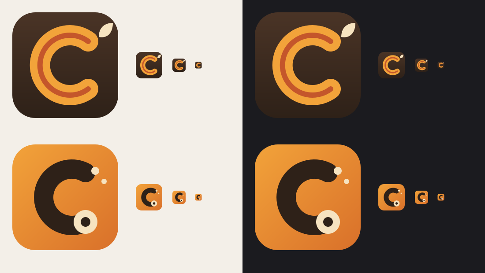
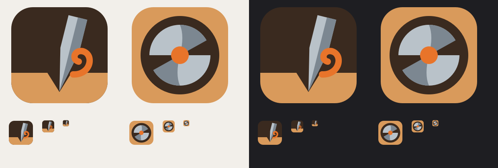
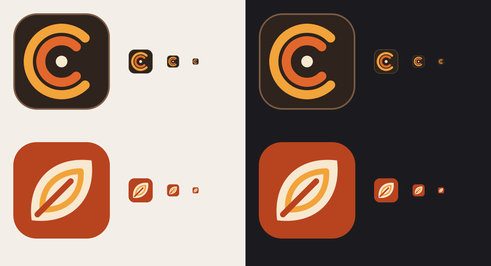

# Carvetto icon candidates

Six original candidates in three directions. Pick one (or ask for changes).
Each folder has the SVG sources (`v1.svg`, `v2.svg`), PNG renders (16–256 px), `preview.png` and `notes.md`.

## A: letter C

## B: cutting bit

## C: toolpath

