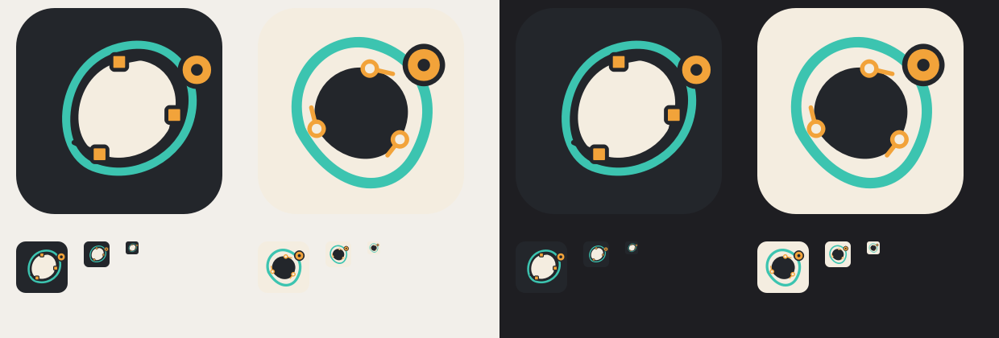
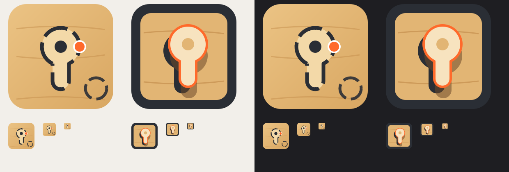
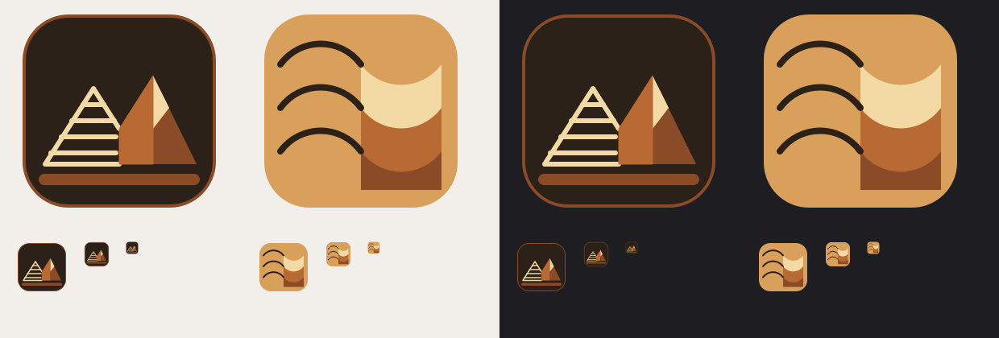
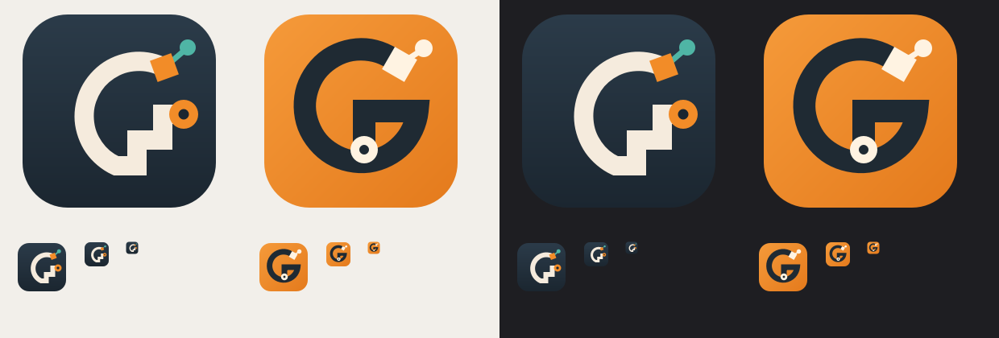

# Carvetto icon candidates, round 2

Briefed on what the app does: a drawn design becomes a machined part. Round 1 is one folder up.

## D: curve to cut (Bezier nodes, offset toolpath, cutter)

## E: stock sheet, part being cut out

## F: relief (toolpath lines becoming carved 3D relief)

## G: monogram (G for G-code: curve turns into a stepped machine path)

