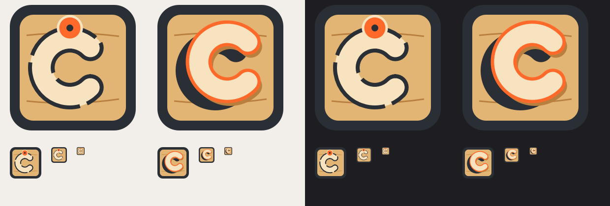

# Carvetto icon candidates, round 3

Direction E (stock sheet) revised: the part being cut out is now the letter C.

## E-c-cut

- **v1** mid-cut, top-down: C outlined on the sheet by a tabbed cut line with the cutter on the path.
- **v2** cut complete: the C lifts out of the sheet, leaving a C-shaped pocket.
